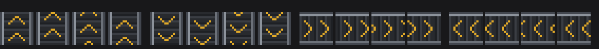

# MC AddOns · 传送带 & 自动炮台

网易我的世界 MCStudio（基岩版 AddOn）两个自制模组的源码 / 成品包 / 配图集合。

| 模组 | 命名空间 | 版本 | 成品包 |
| --- | --- | --- | --- |
| 传送带 | `conveyor` | v0.0.6 | [mods/chuan-song-dai-mod.zip](mods/chuan-song-dai-mod.zip) |
| 自动炮台 | `turret` | v0.0.5 | [mods/pao-tai-mod.zip](mods/pao-tai-mod.zip) |

两个包都是标准的「行为包 + 资源包」双包结构，导入 MCStudio 或直接拖进 `development_behavior_packs` / `development_resource_packs` 即可使用。

---

## 一、传送带（conveyor）



**四方向分体方块**：`conveyor:belt_north` / `belt_south` / `belt_east` / `belt_west`。
方向由方块本身决定（北 = -Z，南 = +Z，东 = +X，西 = -X），顶面贴图带 8 帧滚动动画，
**贴图动画方向与推动方向永远一致**，不会出现"箭头往前、物品往后"。

- **速度档**：空手右键循环切换 停止 → 1 档 → 2 档 → 3 档 → 停止（0 / 0.10 / 0.18 / 0.28 格每处理节拍），档位存方块实体数据，随存档持久化。
- **换向**：直接放另一个方向的传送带，相邻传送带可接力、可拐弯。
- **物流链路**：传送带正下方若是容器（漏斗 / 箱子 / 木桶 / 投掷器 / 发射器 / 潜影盒），这一段即为**卸料点**——物品不再被继续推动，而是直接搬进容器空槽并销毁实体；容器满了就留在带上等，一有空位立刻入库。经典用法：带上末端下方放漏斗，漏斗接箱子。
- **推动规则**：只有站在带上、脚底贴着上表面的实体被推动；垂直方向轻度居中吸附，长距离输送不跑偏；正前方是实心方块时不硬顶，前方是任意方向传送带则正常接力。
- **性能**：tick 处理按坐标哈希错峰，长带不会在同一帧集中计算。

## 二、自动炮台（turret）


方块 `turret:turret` + 遥控器物品 `turret:remote`。

**模式**（空手右键炮塔循环切换，提示条里始终带当前模式）：

| 模式 | 行为 |
| --- | --- |
| 0 待机 | 不索敌 |
| 1 警戒 | 只打敌对生物（僵尸 / 骷髅 / 苦力怕等白名单） |
| 2 清剿 | 打所有生物（不含玩家） |
| 3 无差别 | 含玩家，慎用 |

**战斗**

- 半径 16 格内选最近合法目标，每 8 tick（0.4 秒）最多打一发。
- 发射的是引擎抛射物「追踪箭」（`targetId` 追踪，与跟踪导弹同款），伤害 / 弹道 / 命中判定全交给引擎。
- **弹药无限**（`UNLIMITED_AMMO = True`），不用装填；改回 `False` 即恢复"96 发上限、每发 8 支箭"的有限弹药模式。
- **箭矢自动清理**：脚本跟踪自己射出的箭，存在满 100 tick（5 秒）即销毁——怪打完战场不留一地插着的箭；命中后由引擎正常回收，不受影响。
- 多个炮塔按坐标哈希错峰开火，不会挤在同一帧。

**遥控器**

- 手持遥控器右键炮塔 = 绑定；右键另一座炮塔 = 改绑。
- 绑定后右键其它方块 = 远程循环切模式，提示带模式与距离。
- 半径 64 格、必须同维度；目标被拆自动解绑。绑定关系存玩家 extraData，断线重连不丢。

## 三、仓库结构

```
mods/      成品 AddOn 包（可直接导入）
images/    模组商店配图（组件图标 / 迭代图标 / 设备图 / 轮播图，体素风格）
preview/   开发期的贴图预览图
tools/     生成脚本与离线测试
```

`tools/` 里的脚本：

- `gen_belt_textures.py` / `gen_turret_textures.py` / `gen_remote_icon.py` / `finalize_images.py` —— PIL 生成方块贴图、物品图标、商店配图（含镜像填充去水印）。
- `gen_turret_project.py` —— 按 MCStudio 目录规范生成炮台工程骨架。
- `mcpclient.mjs` —— 直连 MCStudio MCP（SSE，端口 19131）建工程 / 导入资源的小客户端。
- `test_conveyor.py` / `test_turret.py` —— **stub 掉 `mod.server.extraServerApi` 的离线单测**，不启动游戏就能跑服务端逻辑（炮台 27 个用例全过）。

```bash
python tools/test_turret.py     # 27 passed
python tools/test_conveyor.py
```

## 四、配图

| 文件 | 尺寸 | 用途 |
| --- | --- | --- |
| `images/1_component-icon_1000x1000.png` | 1000×1000 | 组件图标 |
| `images/2_iteration-icon_992x558.png` | 992×558 | 迭代图标 |
| `images/3_device_900x580.png` | 900×580 | 设备图 |
| `images/4~6_carousel-*_992x558.png` | 992×558 | 轮播图 |
